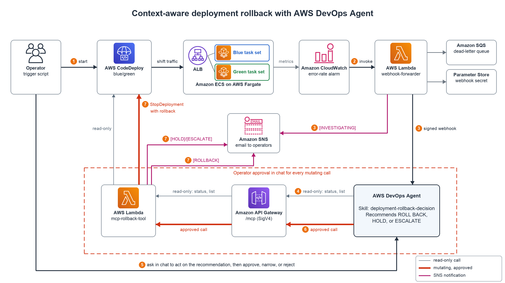

# Architecture

This document describes the components of the Intelligent Rollback system and how they interact.

## Overview

The system implements an automated, AI-driven rollback flow. A deployment that
degrades service health triggers a CloudWatch alarm, which notifies the AWS
DevOps Agent through a signed webhook. The agent evaluates the situation and,
when appropriate, invokes a custom MCP (Model Context Protocol) tool to roll
the deployment back through AWS CodeDeploy. When the evidence points away from
the deployment, the agent uses the same tool to notify operators instead.

## Components

### Sample Application (`sample-app/`)
A Flask microservice deployed to ECS Fargate via CodeDeploy blue/green. It
exposes `/health`, `/`, and `/info` endpoints and publishes custom CloudWatch
metrics (`RequestCount`, `ErrorCount`, `Latency`) under the
`IntelligentRollback` namespace. Failure behavior is controlled by the
`ERROR_RATE` and `LATENCY_MS` environment variables, so a "bad" version can be
deployed by changing the ECS task definition without changing code.

### CloudWatch Alarm (`deploy/cloudwatch-alarm.json`)
A metric math alarm that computes `100 * ErrorCount / RequestCount` from the
sample app's metrics. When the error rate stays above 5 percent for three
consecutive 60-second periods, the alarm transitions to `ALARM` and invokes the
Webhook Forwarder Lambda. `deploy.sh` creates it with
`aws cloudwatch put-metric-alarm --cli-input-json`.

### Webhook Forwarder (`webhook-forwarder/`)
An AWS Lambda function that parses the CloudWatch alarm action event
(`alarmData`), transforms it into the payload described by
`devops-agent/deployment-metadata-schema.json`, and enriches it with the active
CodeDeploy deployment (ID, status, start time) for the deployment group. Every
alarm fired during the same deployment carries the same deployment ID, so the
agent can correlate them. It signs the payload with HMAC-SHA256
(`X-Hub-Signature-256` header) using a secret read from Parameter Store and
POSTs it to the agent's https webhook endpoint. It only forwards `ALARM` state
changes.

### AWS DevOps Agent
Receives the signed webhook, verifies the signature, and works through the
decision runbook (temporal correlation, error type classification, dependency
health, blast radius) to decide whether to roll back, hold and monitor, or
escalate. It acts through the MCP Rollback Tool.

### MCP Rollback Tool (`mcp-rollback-tool/`)
An AWS Lambda function exposed as an MCP tool. It supports `rollback`, `stop`,
`status`, `list`, and `notify` actions. Rollback runs `StopDeployment` with
`autoRollbackEnabled=True`. Before any CodeDeploy call it validates the
deployment ID format, that the deployment belongs to the configured
deployment group, and that it is still active. Errors are classified as
validation, transient (retryable), or permanent. Configuration comes from the
`/intelligent-rollback/config` Parameter Store parameter.

### DevOps Agent Space configuration (`devops-agent/`)
- `mcp-tool-definition.json`: MCP tool schema matching the Lambda event contract
- `deployment-metadata-schema.json`: JSON Schema of the webhook payload
- `rollback-decision-runbook.md`: the decision framework and the tool call for
  each outcome

### SNS Notifications
Operators are notified of rollback actions, and of hold or escalate decisions
through the `notify` action, on an SNS topic so humans stay informed even though
the flow is automated.

## End-to-End Flow

1. Sample app is deployed via CodeDeploy blue/green to ECS Fargate.
2. CloudWatch alarm detects an anomalous error rate or latency.
3. The alarm invokes the Webhook Forwarder Lambda.
4. The Webhook Forwarder signs and posts the event to the AWS DevOps Agent webhook endpoint.
5. The AWS DevOps Agent evaluates the situation and invokes the MCP Rollback Tool.
6. To roll back, the MCP Rollback Tool calls CodeDeploy `StopDeployment` with
   auto-rollback enabled. To hold or escalate, it calls `notify` instead.
7. An SNS notification is sent to operators.

## Security Notes

- Webhook payloads are authenticated with an HMAC-SHA256 signature derived from a
  shared secret stored as a Parameter Store SecureString
  (`/intelligent-rollback/webhook-secret`), so the agent can verify requests
  originate from this Lambda. The secret is not stored in Lambda environment
  variables and is never logged.
- Each Lambda function has its own IAM role (`deploy/iam/`). Only the MCP
  Rollback Tool can call `StopDeployment` and `sns:Publish`; the Webhook
  Forwarder has read-only CodeDeploy access. Neither function has a function URL.
- IAM policies follow least privilege where the API supports resource-level
  permissions. `codedeploy:StopDeployment`, `GetDeployment`,
  `BatchGetDeployments`, and `ListDeployments` are scoped to this sample's
  application and deployment group; `cloudwatch:PutMetricData` does not support
  resource-level permissions and is constrained by a namespace condition.
- The demo Application Load Balancer serves plain HTTP on port 80 for simplicity.
  Production deployments should add an HTTPS listener with an ACM certificate and
  terminate TLS at the ALB.
